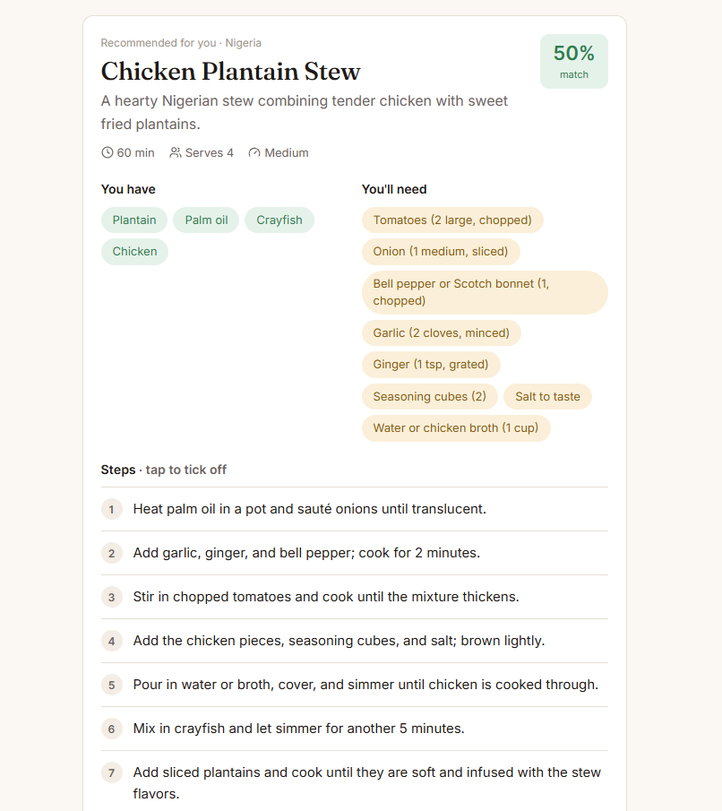

# Newtz Chef: Food Recipe

An AI cooking assistant built with React. Tell it what's in your kitchen, or just describe the meal you want, and it writes a short, step-by-step recipe in the style of the region you pick (Nigeria, Africa, or Europe/UK).

**Live demo:** _add your Netlify link here_

<!-- Add a screenshot after deploying: save it as screenshot.png in the project folder, then remove the comment marks below -->
<!--  -->

## Features

- **Cook from what you have:** add 4 or more ingredients and get the meal that best matches them, plus a list of anything missing.
- **Describe a meal:** type something like "jollof rice" and get the ingredients and steps.
- **Regional recipes:** choose Nigeria, Africa, or Europe/UK.
- **Your API key stays private:** the AI request runs in a Netlify Function, so the key never reaches the browser.

## Tech stack

- [React 19](https://react.dev/) + [Vite](https://vite.dev/)
- [Hugging Face Inference](https://huggingface.co/docs/inference-providers) running DeepSeek-R1
- [Netlify Functions](https://docs.netlify.com/functions/overview/) for the server-side API route
- [react-markdown](https://github.com/remarkjs/react-markdown) to display the recipe

## How it works

```
Browser (React)  ──POST /api/recipe──▶  Netlify Function  ──▶  Hugging Face (DeepSeek-R1)
                 ◀──── recipe text ────  (holds the API key)
```

- `src/`: the React app
- `netlify/functions/recipe.mjs`: the server route that builds the prompt and calls the AI
- `vite.config.js`: runs that same function during local development

## Run it locally

1. Install dependencies:
   ```bash
   npm install
   ```
2. Copy `.env.example` to `.env` and add your [Hugging Face token](https://huggingface.co/settings/tokens):
   ```
   HUGGINGFACE_API_KEY=your_hugging_face_token_here
   ```
3. Start the dev server:
   ```bash
   npm run dev
   ```

## Deploy to Netlify

1. Push the repo to GitHub and import it in Netlify. The build settings come from `netlify.toml`.
2. In **Site configuration → Environment variables**, add `HUGGINGFACE_API_KEY`.
3. Deploy.

## What I learned

This was my first React project. It covers components and props, `useState`, forms, rendering lists, calling an AI API, and keeping secrets off the front end.
